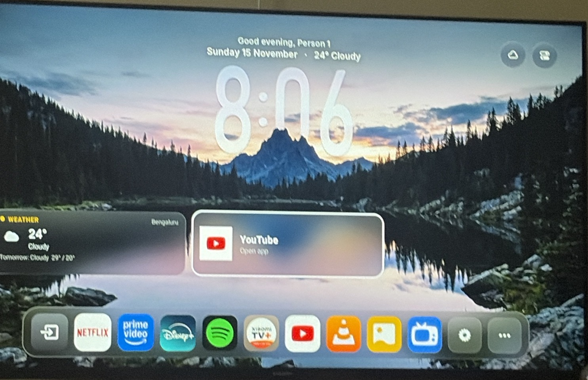

# TV Home

A home screen (launcher) for Android TV and Google TV with a clean, glassy tvOS-style look. It has a customizable widget row, a media player widget, an app dock with an "all apps" view, a built-in debloater and in-app updates.

<p align="center">
  
  <br>
  <sub>Photo of TV Home running on a Xiaomi 43" 4K Pro (Android TV 11).</sub>
</p>

> **Status:** personal project, tested on one TV (Xiaomi TV 43" 4K Pro, Android TV 11, model `MiTV-MOOR2`). It should work on other Android TV 8+ devices, but that has not been verified. Please open an issue if something breaks on your TV.

TV Home is a fork of [tvOS Launcher](https://github.com/techgenius1/tvOS-Launcher) by techgenius, which does most of the heavy lifting. See [Credits and license](#credits-and-license) and [CHANGES.md](CHANGES.md) for exactly what was changed.

## Features

**What this fork adds**

- **Media player widget.** Shows whatever is playing in any app (Spotify, YouTube Music, VLC and others) with artwork, title and artist. Press OK to play or pause. Hold OK for next/previous track or to remove it. When nothing is active it shows the last thing you played and OK opens that app.
- **Weather-only home by default.** Prayer times, football and "most watched" widgets are off unless you turn them on.
- **App widgets.** Add a tile for any installed app from Settings.
- **Hold OK on a widget to remove it**, then add it back from Settings.
- **Customize home screen hub.** One screen for dock apps, dock size, widgets and wallpaper. Press OK on the home screen to open it.
- **Navigation that follows the screen layout.** Dock → widgets → home screen → top-right buttons. Press Down on the dock to open all apps.
- **Update from Settings.** Checks this repository's [Releases](../../releases) and installs the new APK. No cable or adb needed after the first install.
- **On-screen crash report.** If the launcher crashes, the next launch shows the error so you can report it without a computer.

**What it inherits from tvOS Launcher**

Liquid Glass dock with adjustable size, Night Scenes and Classic looks, a big glass clock, custom and shuffled wallpapers, weather, profiles, Continue Watching, search, a Control Center-style panel, recent apps, a remote button mapper, a built-in PC-free debloater (CleanYourTV), local ADB setup, lock screen and screensaver, and an icon editor. The original documentation is kept in [docs/upstream](docs/upstream). Features described there are inherited code, and not all of them have been re-tested in this fork.

Full list: [docs/features.md](docs/features.md).

## Install

You need an Android TV or Google TV on the same network as a PC. The full walkthrough is in **[docs/install.md](docs/install.md)**. In short:

1. On the TV, enable Developer options and **Network debugging** (or ADB debugging).
2. Download `TVHome.apk` from the [latest release](../../releases/latest).
3. On your PC, with [Android platform-tools](https://developer.android.com/tools/releases/platform-tools):
   ```
   adb connect <TV-IP>:5555
   adb install -r TVHome.apk
   ```
4. Make it the default home app:
   ```
   adb shell cmd role add-role-holder --user 0 android.app.role.HOME com.pandxsah.tvhome
   ```

To go back to your original launcher, see [Restore the original launcher](docs/install.md#restore-the-original-launcher).

## Updating

Open **Settings → Updates → Check for updates**. If a newer release exists, TV Home downloads and installs it. Details and how to publish a release are in [docs/updating.md](docs/updating.md).

## Build from source

No Gradle. A shell script uses the plain Android SDK tools. See [docs/building.md](docs/building.md).

## Troubleshooting

`unauthorized` in adb, the launcher bouncing back to the old one, or a widget that stays empty: see [docs/troubleshooting.md](docs/troubleshooting.md).

## Privacy

TV Home has no analytics or ads. It makes network requests for features you use: weather, optional widgets (prayer times, football, releases), the update check against this repository's GitHub Releases, and any wallpaper or watch-history integration you configure (inherited from the original project). Seeing what is playing for the media widget needs **notification access**, which stays on the TV.

## Credits and license

- **tvOS Launcher** by [techgenius](https://github.com/techgenius1/tvOS-Launcher), Apache License 2.0. This project is a modified version of it.
- Also credited upstream: Hume Launcher, Couch TV, CleanYourTV. See [NOTICE](NOTICE).
- Inter typeface (SIL OFL 1.1) and the Nayuki QR code library (MIT), both bundled.

Licensed under the [Apache License 2.0](LICENSE). Modifications are described in [CHANGES.md](CHANGES.md).

TV Home is not affiliated with or endorsed by Apple, Google, Xiaomi or any streaming service. "Apple TV" and "tvOS" are trademarks of Apple Inc.; they are mentioned only to describe the visual style.
